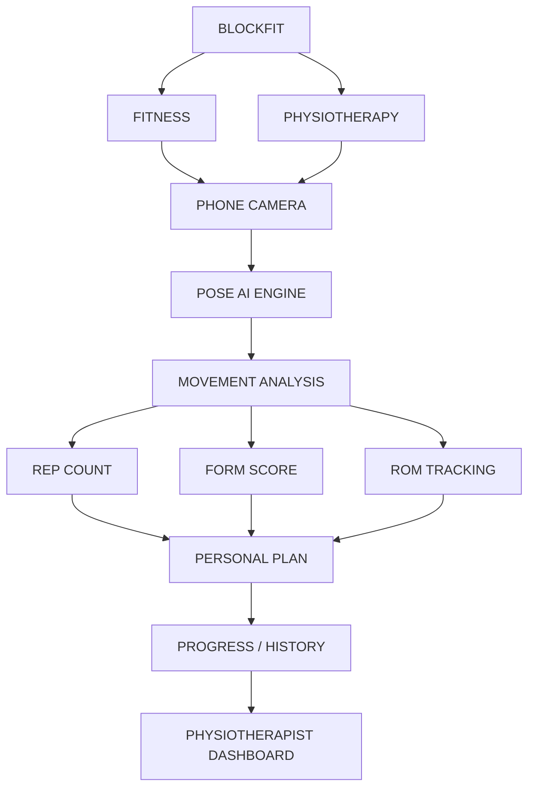

# BlockFit

BlockFit is an AI-powered movement, fitness, and rehabilitation companion. The app analyzes exercise movement and helps people review their progress; it is not a medical diagnostic tool or a substitute for professional care. The initial product market is India, with clear patient consent and privacy controls for clinician access and rehab data.

## Product Flow



This is the target product journey. Personal plans and the physiotherapist dashboard are planned capabilities and are not yet available in the current app.

See [the repository reference map](docs/REPOSITORY_REFERENCE_MAP.md) for entry points, routes, configuration, assets, and cleanup decisions.

The product is split into three folders with separate web and Android builds:

- `backend/` holds the API and PostgreSQL integration.
- `web/` holds the browser app and Vite build. The web app uses `/api` on the same host.
- `mobile/` holds the Capacitor configuration and native Android project at `mobile/android/`.

The APK packages the shared web interface, but it is a separate Android build and calls the public API over HTTPS. Do not move Android files back into `web/`.

## Public Deployment

The included `render.yaml` deploys the web app and API together and provisions PostgreSQL. In Render, create a Blueprint from this repository and wait for the service to finish deploying. The service's `onrender.com` URL is the public web URL; its API is at the same URL plus `/api`. This makes the browser app available outside your local network. The server binds to Render's `PORT` and uses `DATABASE_URL` for persistent accounts and workouts.

The repository only configures deployment; it cannot publish the service without access to your Render account. Until the Blueprint is deployed, there is no public API URL for an APK to call.

For GitHub Actions APK builds, add the deployed API URL as the repository variable `BLOCKFIT_API_URL` under **Settings > Secrets and variables > Actions > Variables**, for example `https://your-service.onrender.com/api`.

## Local Web Development

Install dependencies once:

```bash
npm ci --prefix backend
npm ci --prefix web
```

Run `npm run dev:api` and `npm run dev:web` in separate terminals, then open http://localhost:5173. Vite proxies `/api` to the local backend on port 4000. On Windows, `start.bat` launches both.

To serve the production web build and API together locally:

```bash
npm run build
npm start
```

Open http://localhost:4000. The production web build also uses `/api`, so it stays same-origin with the API.

Without `DATABASE_URL`, development uses in-memory data for tests only; accounts disappear when the backend restarts. Production requires the Render database and `JWT_SECRET`. Password-reset email additionally requires `SMTP_HOST`, `SMTP_PORT`, `SMTP_SECURE`, `SMTP_USER`, `SMTP_PASS`, `SMTP_FROM`, and `CLIENT_APP_URL`. Keep mail credentials on the server, never in the web app or APK.

## Android APK

Requirements: Node.js 20+, JDK 21, and an Android SDK. Deploy the backend first, then configure the mobile build with its public HTTPS API URL.

1. Copy `mobile/api-config.example.json` to `mobile/api-config.json` and replace the example URL with the deployed API URL ending in `/api`.
2. Install the Android project dependencies with `npm ci --prefix mobile`.
3. From the project root, run `npm run apk:build`.

The build validates the URL, builds `web/`, syncs its output into Capacitor, and assembles the APK. The output is `mobile/android/app/build/outputs/apk/debug/app-debug.apk`. The API URL is embedded at build time; rebuilding is required if the public API URL changes.

To open the native project in Android Studio, run `npm run apk:open`. The Gradle project is under `mobile/android/`; the browser app remains under `web/`.

## Tests

```bash
npm run benchmark:test
node --test backend/test/*.test.js
```
