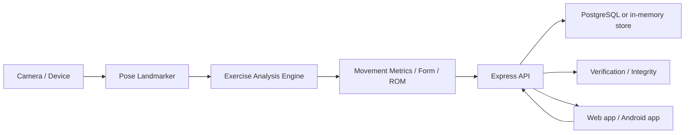
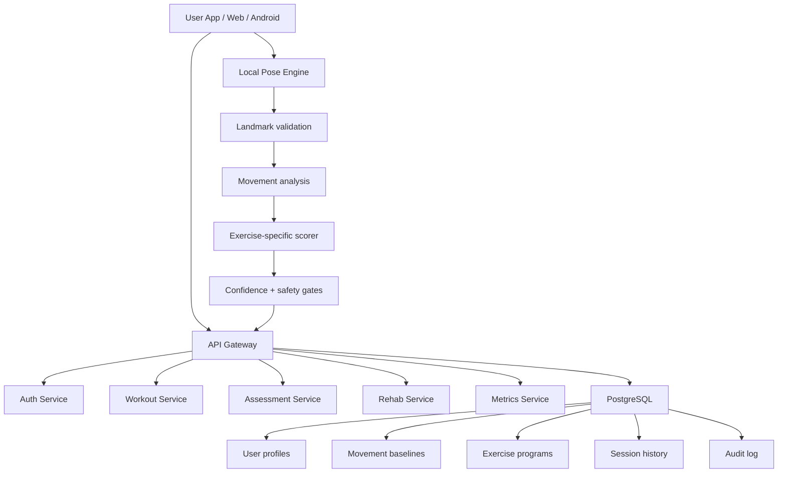

# BlockFit V2 Audit (Historical)

Status: Historical PHASE 0 assessment. Its proposed architecture and blockchain-demo findings are superseded; no public-chain feature is part of the current product. See `docs/ARCHITECTURE.md`, `docs/PHASE_PLAN.md`, and `BLOCKFIT_AUDIT.md` for current direction.
Date: 2026-10-05
Repository path: C:\Users\nisha\Desktop\final blockfit\final blockfit\BlockFit_Enhanced

## Executive summary

BlockFit already contains a viable foundation for a fitness + rehabilitation AI app: Express API, middleware protections, session auth, verification endpoints, a MediaPipe-based pose pipeline, exercise analyzers, and working API regression tests. The code is not a blank slate or a failed prototype; it is a functioning MVP with real feature seams.

The biggest gaps are organizational, not conceptual:

- the product is mixing demo blockchain, verification, and production app concerns in the browser;
- the project has a strong API skeleton but not yet a clean movement-analysis architecture for physiotherapy-grade monitoring;
- the pose system is capable but not yet structured as a privacy-first, confidence-aware, offline-aware pipeline;
- the app is missing a proper V2 model for baseline assessment, physiotherapy programs, adaptive workout generation, and explainable metrics;
- there are production risks around secret fallbacks and browser-local integrity logic that should not be treated as product trust layers.

This audit recommends a non-destructive transition: keep the working API and pose logic, refactor the architecture around a reusable movement-analysis layer, remove or isolate demo blockchain features, and only then add the physiotherapy-specific bones of the V2 platform.

---

## 1) Current architecture

### Top-level project structure

Repository root:

- `package.json`: orchestrates `backend`, `web`, and `mobile` workspaces and common scripts.
- `backend/`: API server and persistence layer.
- `web/`: SPA frontend with Vite and a separate browser app UI.
- `mobile/`: Android/Capacitor project.
- `ai/`: exercise engine and repetition state machine.
- `blockchain/`: SHA-256 verification helpers and public verification payload utilities.
- `shared/`: shared-type or contract support.

### Runtime architecture

### Frontend

The browser app is a single-page app under `web/src` and routes to pages such as:

- `web/src/app.js` for top-level routing and shell layout
- `web/src/pages/workout.js` for camera workflow and live rep tracking
- `web/src/pages/dashboard.js`, `history.js`, profile.js, login.js, register.js, verify.js
- `web/src/pose/*.js` for MediaPipe landmarker wrappers and geometry utilities
- `web/src/exercises/*.js` for exercise-specific analyzers (squat, push-up, lunge, plank, bicep curl)
- `web/src/ui/overlay.js` for pose skeleton drawing
- a removed demo-only browser chain that was retired from the user-facing product

The front-end behavior is meaningful and integrated with the API; it is not just a mock. It includes a real camera flow and workout save path.

### Backend

The backend is in `backend/src` and is set up as an Express API with:

- `app.js`: security middleware, CORS, rate limiting, health endpoint, static web output, and route registration
- `server.js`: port binding for the API
- `config/env.js`: environment configuration and allowed origins
- `lib/auth.js`: JWT signing and password hashing
- `lib/dataStore.js`: storage abstraction with Postgres support if `DATABASE_URL` exists, otherwise in-memory fallback
- `lib/integrity.js`: server-side HMAC/SHA-256 style integrity helpers
- `middleware/auth.js`: JWT verification
- `routes/auth.js`: register, login, forgot-password, reset-password
- `routes/workouts.js`: nonce issuance, workout history, workout creation
- `routes/verification.js`: public verification route and account-holder-driven revocation
- `routes/analytics.js`: lightweight event ingestion
- `routes/users.js`: current-user retrieval and self-deletion

This is a credible API layer, but it does not yet model a therapist or physiotherapy program domain.

### Database

The current project uses a storage abstraction that supports PostgreSQL when `DATABASE_URL` is configured and falls back to in-memory data when the DB is absent. The code is structured to allow a real database but the default app path is still not a production-grade schema for rehab data.

Relevant files:

- `backend/src/lib/dataStore.js`
- `backend/src/db/database.js` for the in-memory and schema-oriented storage definitions
- `backend/src/db/schema.sql` for database schema work

### AI / pose pipeline

The pose pipeline is centered on a MediaPipe `PoseLandmarker` wrapper in `web/src/pose/poseDetector.js`.

Current flow:

- model loads from a CDN (`@mediapipe/tasks-vision`)
- `detectFrame()` returns only landmarks when the required landmarks are visible enough
- exercise analyzers compute joint angles and phase changes
- skeleton overlay draws results in canvas
- a repeating `requestAnimationFrame` loop tracks form and rep completion

The exercise analyzers are already domain-specific and should be considered a valuable starting point:

- `web/src/exercises/squat.js`
- `web/src/exercises/pushup.js`
- `web/src/exercises/lunge.js`
- `web/src/exercises/plank.js`
- `web/src/exercises/bicepCurl.js`

### Verification / integrity

Verification and integrity are a noteworthy strength:

- `backend/src/routes/verification.js`
- `blockchain/verify.js`
- `backend/src/lib/integrity.js`

There is a canonical verification payload and public verification page. This is useful as an internal audit trail, but it is not a product requirement to be presented as blockchain in the user-facing app.

### Security and production posture

There are meaningful security controls already in place:

- Helmet with CSP disabled for compatibility
- CORS allow-list
- `express-rate-limit`
- JWT auth
- password hashing with `bcryptjs`
- validation with `zod`
- server-side HMAC for record integrity

The biggest production risks are not absent security controls; they are weak default secret values and public-facing demo/blockchain semantics.

---

## 2) Files/components to KEEP

These are the strongest existing components to keep and evolve:

### Keep as-is or minimally refactor

- `backend/src/app.js` — good API composition and rate-limiting foundation
- `backend/src/config/env.js` — central env handling; needs stronger production enforcement
- `backend/src/lib/auth.js` — JWT + password hashing logic is a solid core
- `backend/src/lib/dataStore.js` — storage abstraction is useful as a boundary
- `backend/src/routes/auth.js` — strong auth flow foundation
- `backend/src/routes/workouts.js` — good nonce and workout record structure
- `backend/src/routes/verification.js` — useful verification and public record pattern
- `backend/test/*.test.js` — existing regression suite is valuable and should be extended
- `web/src/pose/poseDetector.js` — this is the right place to build a production-grade pose pipeline
- `web/src/pose/angles.js` — good pure math layer and reusable geometry helpers
- `web/src/pose/landmarks.js` — useful landmark mapping layer
- `web/src/exercises/squat.js` — established baseline analyzer with movement logic
- `web/src/exercises/pushup.js`, `lunge.js`, `plank.js`, `bicepCurl.js` — strong start for a small, curated exercise library
- `web/src/ui/overlay.js` — a sensible canvas overlay layer
- `blockchain/verify.js` — keep the hashing logic internally for evidence and record integrity; de-emphasize public blockchain positioning
- `docs/ARCHITECTURE.md` and related docs — keep as the repository’s design history and expand them

### Should be retained conceptually, not necessarily as-is

- `ai/exerciseEngine.mjs` and `ai/repStateMachine.mjs` — these are useful concepts for a reusable movement-analysis engine, but they should be integrated into the production runtime architecture rather than treated as an isolated prototype module
- `backend/src/routes/analytics.js` — good for event capture, but analytics should become structured wellness / readiness metrics rather than generic event logging

---

## 3) Files/components to MODIFY

The following are not broken, but they are misaligned with a V2 production app:

- `backend/src/config/env.js`
  - Remove permissive development fallback secrets in production.
  - Make the system explicit about required environment variables.
  - Do not rely on bare default JWT values outside local development.

- `backend/src/lib/dataStore.js`
  - Add a real physiotherapy and movement baseline model layer for patient/program/session history.
  - Keep the abstraction, but expand the schema contract.

- `backend/src/routes/workouts.js`
  - Add measured ROM fields, movement score fields, asymmetry fields, and exercise readiness metadata.
  - Ensure the server accepts structured movement analysis outputs instead of only simplified summary data.

- `backend/src/routes/verification.js`
  - Keep the verification concept, but ensure it is framed as an internal integrity record, not a public consumer-facing blockchain feature.

- `web/src/pages/workout.js`
  - Replace the browser-local blockchain demo with a structured movement-analysis event model.
  - Add safe exercise pre-checks, movement confidence, camera framing checks, and voice feedback toggles.

- `web/src/pose/poseDetector.js`
  - Add landmark confidence handling, visibility checks, smoothing, and offline-capable model caching strategy.
  - Replace CDN-only assumptions with a clearly documented local/offline fallback plan.

- `web/src/exercises/*.js`
  - Add proper exercise metadata: required landmarks, camera position, phases, form checks, ROM logic, response thresholds, safety conditions, and confidence thresholds.

- `docs/*.md`
  - Update all docs to reflect the V2 architecture and replace prototype language with privacy-first clinical-support language.

---

## 4) Files/components to REPLACE

These are currently the most likely product-level replacements:

### Browser-local demo blockchain

- removed from the active product UI

This was a useful educational and integrity example, but it is not a production-grade product feature. It should not be visible as the core “proof” layer for the app. Replace it with:

- internal SHA-256 event/audit hashing
- signed session records or server-side integrity records
- a clear backend-only verification model
- optional tamper-evidence for internal audit logs, not public compensation or tokenized features

This is the clearest “delete or isolate” candidate.

### Exercise engine layering

The current project has multiple valid bits of logic spread across the UI and exercise modules. Replace the informal pattern with a dedicated movement-analysis layer that owns:

- landmark validation
- smoothing
- joint angle calculations
- phase detection
- repetition counting
- form scoring
- confidence evaluation
- exercise-specific feedback

That should be a reusable service layer, not a UI convenience.

### Workout generation assumptions

The app should not rely on free-form LLM-generated workout prescriptions. Replace the current ad hoc “workout save + repo story” behavior with a deterministic rules engine or exercise-library-driven adaptive logic.

---

## 5) Files/components to DELETE or defer until approval

The audit has not deleted anything. The following are candidates only after approval and a migration plan:

- the old product-facing chain demo, which has been removed from the live app
- stale empty outer workspace folders that are not the canonical source of truth
- older duplicate or demo-only files not imported anywhere by the working app
- any unused browser-only “proof of workout” claims that are not tied to secure server validation

The project should avoid destructive changes before the architecture transition is approved.

---

## 6) Current bugs/problems and technical risks

### 6.1 Security / configuration risk

- `backend/src/config/env.js` falls back to hardcoded development secrets when production env values are missing.
- This should never be accepted as product-grade security.
- A production app must fail closed if the security config is missing.

### 6.2 Unclear product boundary for blockchain

- The app has a browser-local blockchain chain persisted in localStorage.
- This is a demo mechanism, not a production trust layer.
- It also encourages a false “proof” narrative that could be interpreted as a public immutable record when it is not.

### 6.3 Core AI pipeline is not yet a production movement-analysis architecture

The current system has exercise logic, but not a formal pipeline that includes:

- landmark confidence
- visibility checks
- smoothing
- noisy landmark handling
- camera framing validation
- body visibility validation
- movement confidence
- exercise confidence
- safety gating based on poor pose confidence

### 6.4 Physiotherapy / rehab is not first-class

The current app is fitness-first and includes a few exercise analyzers, but not:

- prescribed physiotherapy programs
- therapist-assigned plans
- baseline/target ROM tracking
- asymmetry tracking by side
- session reporting and adherence
- rehab disclaimers and safety checks

### 6.5 Pose model assumptions are fragile

- The model is loaded from a CDN rather than local bundles.
- This risks a poor offline experience and is not ideal for Android or limited-network use.
- `detectFrame()` assumes a threshold and simple visibility gating, but it is not yet a full movement confidence pipeline.

### 6.6 Data model does not yet reflect rehab needs

The app has workout data but not a robust movement baseline, assessment, and progression model needed for future scoring, ROM, and rehab optimization.

### 6.7 API contracts and product language are not yet aligned to V2

The app is currently described as a “workout tracking and verification” app. That must evolve to “AI-assisted movement monitoring and rehabilitation support” while retaining the non-diagnostic disclaimer.

### 6.8 No production-ready physiotherapist account model

No clear role/domain model exists for:

- patient assignment
- session history
- movement results
- progress changes
- exercise program rules
- therapist review and overrides

---

## 7) Missing functionality for the V2 target

The following capabilities are not yet part of the current codebase in a production-ready form:

- Movement assessment onboarding flow
- BlockFit Movement Score model with backend configuration
- baseline movement profile and future comparison
- ROM tracking by joint and side
- asymmetry detection and explanation
- physiotherapy mode with a distinct UI and logic path
- workout builder with deterministic rules and safety constraints
- adaptive difficulty engine based on form, confidence, completion, and fatigue readiness
- optional voice coaching with on/off toggle
- privacy-first local AI caching strategy
- Android-specific camera permission and lifecycle real-device testing
- clear therapist/patient separation and program assignment model
- offline-capable core AI functionality

---

## 8) Recommended architecture for V2

### Proposed architecture (keep current repo but reorganize cleanly)

### Recommended design principles

- One source of truth for exercise metadata and scoring rules
- No duplicate exercise logic between browser and backend
- Keep the app’s primary AI pipeline local-first
- Send only structured results, not raw video, by default
- Use the backend only for persisted data, scoring config, user accounts, and progress history
- Treat verification as internal evidence, not as a consumer-facing blockchain product
- Keep a curated exercise library instead of an unsafe free-form generation model

### Recommended service boundaries

- `apps/web` and `apps/mobile`: presentation and camera UX
- `services/api`: route handling, authentication, persistence, and configs
- `packages/pose-engine`: local pose detection and confidence gating
- `packages/movement-analysis`: geometry, smoothing, scoring, asymmetry computation, and exercise-specific logic
- `packages/shared`: shared schema and API contracts
- `database/models`: user, baseline, session, rehab plan, assessment schemas
- `docs/`: architecture and compliance documentation

This should be done gradually. The current repository is already close to a workable monorepo but does not have the clean service separation yet.

---

## 9) Recommended implementation order

This is the safest order for a V2 transition:

1. Phase 0 — audit and architecture freeze (this report)
2. Phase 1 — secure production config cleanup
3. Phase 2 — isolate and retire browser-local blockchain demo from the user-facing flow
4. Phase 3 — formalize a movement-analysis service and scoring model
5. Phase 4 — add baseline assessment, ROM, asymmetry, and confidence-aware reporting
6. Phase 5 — create physiotherapy mode and structured rehab program data model
7. Phase 6 — add adaptive difficulty and deterministic workout generation rules
8. Phase 7 — add voice coaching, local caching, and offline-safe model strategy
9. Phase 8 — performance validation on real Android devices and expand automated tests

---

## 10) Risky changes requiring confirmation before execution

The following changes should be confirmed before implementation:

- Remove or retire the browser-local blockchain demo from the product UI and backend story
- Rework the app to present BlockFit as AI-assisted movement monitoring, not a medical diagnostic device
- Move from a loose exercise pipeline into a dedicated movement-analysis package
- Add new fields and tables to support rehab baseline, ROM, and asymmetry tracking
- Introduce a therapist/patient role model
- Change the default security posture from permissive dev values to strict production-only config

These are not “nice-to-haves”; they are the real structural changes needed for a production-quality V2 product.

---

## Final assessment

BlockFit currently has a credible MVP foundation and should not be treated as a failed concept. It has real strengths in API security, app flow, pose detection, and exercise logic. However, it is not yet a production-ready AI physiotherapy system because the architecture still mixes:

- fitness and rehab intent,
- demo blockchain trust messaging,
- ad hoc movement logic,
- uncertain production configuration,
- and limited rehab data semantics.

The correct path is not a frantic rewrite. It is a disciplined refactor: keep the valid foundation, remove the product-level blockchain distraction, create a movement-analysis architecture, formalize physiotherapy metrics, and then add the safety and clinician-facing capabilities in a controlled order.

This audit intentionally stops at the architecture decision point and does not perform destructive removal until the team confirms the target direction.
